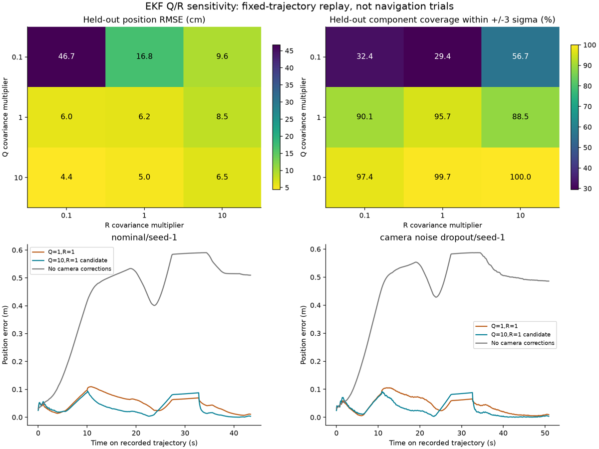
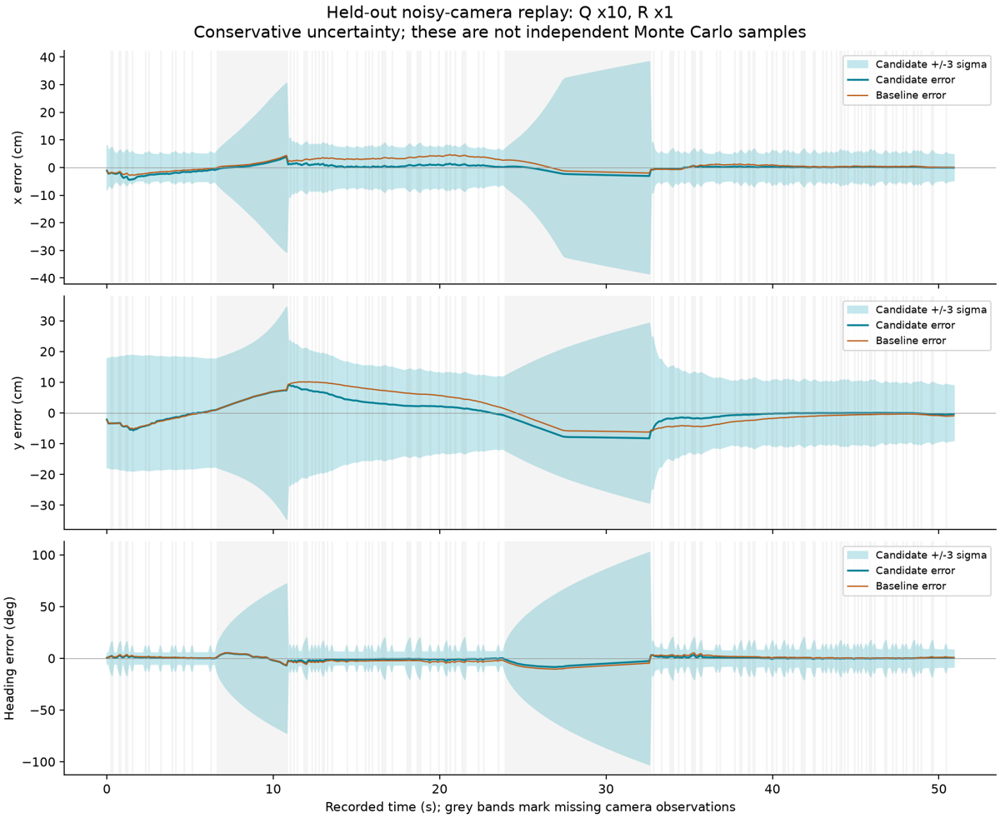
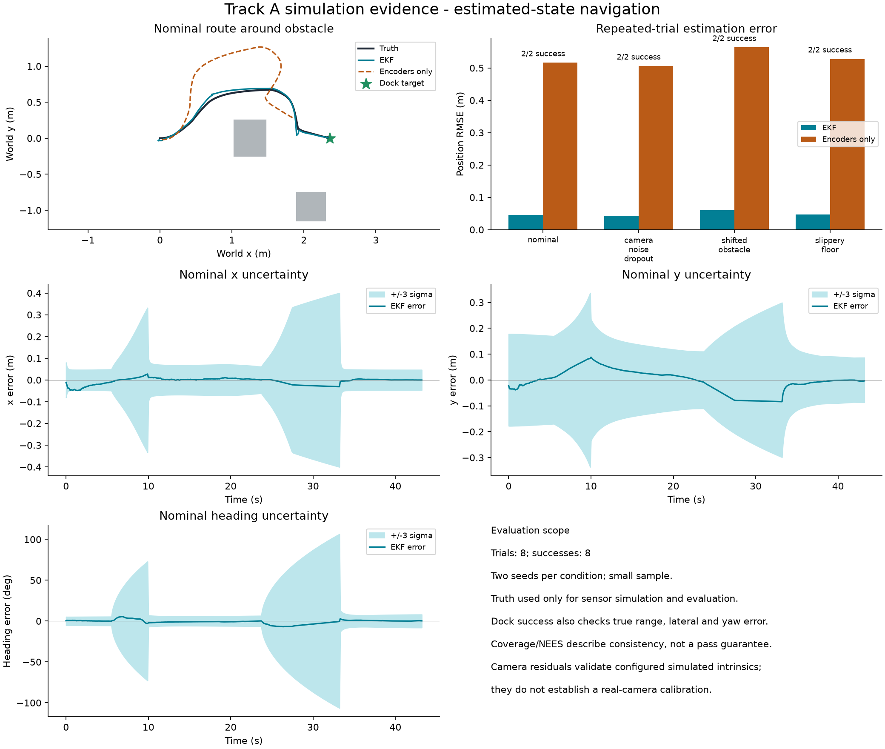

# Part C: EKF state estimation and tuning

**Review draft for Garwood's assigned Part C.** This describes the local simulated
pipeline and measured experiments. It does not certify human authorship or
completion of the assessment. The team must verify the mathematics, reproduce
results and record actual individual contributions and AI assistance before
publishing. The default running pipeline remains Q x1, R x1; Q x10, R x1 is an
explicitly selectable candidate, not an automatically deployed replacement.

## 1. Purpose and interfaces

The estimator supplies a planar base pose and covariance to the navigation
controller. Encoders predict motion when the ArUco marker is unavailable; the
camera corrects accumulated drift when a validated observation is available.
The controller receives the estimated pose, never the simulator's true pose.

The state is

$$\mathbf{s}=[x,\ y,\ \theta]^T.$$

World x and y are in metres, with z upward. Base x points forward and base y
left. Heading is anticlockwise from world +x and wrapped to [-pi,pi).

- **From Part A:** robot dimensions and the differential-drive motion model.
- **From Part B (Gardner):** time-aligned encoder increments and a validated
  marker observation [range, bearing, heading], with the camera/marker transforms
  and calibration assumptions specified. Bearing is positive to the left.
- **To Part D (Wong):** posterior pose, covariance and whether the camera update
  was accepted. The current loop is synchronous at 10 Hz. A real interface should
  include timestamps and reject stale measurements.
- **Shared Part E:** sensor loss, slip, disturbance and end-to-end evaluation.

Simulator pose reads are confined to sensor generation and named evaluation
functions. `PoseEKF` accepts no MuJoCo data/model object. Offline truth is used
only to score errors and uncertainty, after filtering has run.

## 2. Encoder prediction

The Waffle Pi model gives wheel radius r=0.0330085 m and wheel spacing b=0.288 m.
The estimator uses measured encoder changes, not the commanded wheel rates.
For left/right angular increments dl and dr:

$$d=\frac{r}{2}(dl+dr),\qquad \alpha=\frac{r}{b}(dr-dl).$$

For nonzero alpha, the exact planar arc update is

$$x^-=x+\frac{d}{\alpha}[\sin(\theta+\alpha)-\sin\theta],$$
$$y^-=y+\frac{d}{\alpha}[\cos\theta-\cos(\theta+\alpha)],$$
$$\theta^-=\operatorname{wrap}(\theta+\alpha).$$

The implementation uses the straight-motion limit for very small alpha. The
prediction is nonlinear, so its local Jacobians propagate the covariance:

$$P^-=F P F^T+Q_k,\qquad
F=\begin{bmatrix}1&0&-\Delta y\\0&1&\Delta x\\0&0&1\end{bmatrix}.$$

G is the 3x2 derivative of the pose update with respect to wheel increments,
computed by central differences with step 1e-6 rad. Heading differences are
wrapped. The process covariance is

$$Q_k=s_Q\left[G\operatorname{diag}(\sigma_L^2,\sigma_R^2)G^T+
\operatorname{diag}(0.003^2,0.003^2,0.02^2)\right],$$

where sigma_i=0.002+0.04*abs(delta_i) rad. The additive floor accounts for
unmodelled motion/slip and is specified **per 0.1 s estimator update**. It should
not be copied unchanged to another update rate. These are engineering/tuning
values, not independently measured encoder or floor-friction statistics.

## 3. Camera measurement and correction

The known marker is at world (3,0) m. Its known orientation supplies an absolute
heading reference through square-marker PnP. The camera is mounted 0.09 m
forward of the base, 0.30 m high and pitched upward 10 degrees. Its local axes
are converted from OpenCV right/down/forward to robot forward/left/up.

For camera horizontal position c=[x+0.09*cos(theta), y+0.09*sin(theta)] and
Delta=[3,0]-c, the predicted measurement is

$$h(\mathbf{s})=\begin{bmatrix}
\|\Delta\|\\
\operatorname{wrap}(\operatorname{atan2}(\Delta_y,\Delta_x)-\theta)\\
\theta
\end{bmatrix}.$$

The third component is heading inferred from marker **orientation**, not merely
its image centre. Without this orientation information, a single known marker's
range and bearing leave a rotational ambiguity about the marker; it would be
incorrect to claim full absolute-pose observability from those two quantities
alone. The current 3x3 measurement Jacobian is full rank away from the marker
under the known-orientation assumption. When no marker is detected, no absolute
camera correction is performed.

The range/bearing Jacobian uses central differences with step 1e-5 in the state
coordinates; the heading row is [0,0,1]. Given residual nu=z-h(s^-), both angular
residuals are wrapped, followed by

$$S=H P^- H^T+R,\qquad K=P^-H^T S^{-1},$$
$$\hat{s}=s^-+K\nu,$$
$$P=(I-KH)P^-(I-KH)^T+KRK^T.$$

Linear systems are solved instead of explicitly inverting S. The Joseph
covariance update is symmetrised to reduce numerical asymmetry. Camera PnP
must have positive depth, finite values and reprojection error no greater than
3 pixels. An EKF update is rejected if its NIS exceeds 11.345, the 99% threshold
for a nominal three-dimensional Gaussian innovation. This is a diagnostic gate,
not a guarantee that the actual nonlinear/correlated measurements follow that
ideal distribution.

## 4. Initialisation and parameters

The prior mean is [0.025,-0.02,0.025], referenced to a known nominal starting
location. It is not copied from simulator truth. Initial standard deviations
are [0.06 m,0.06 m,5 degrees]. Thus P0=diag(0.06^2,0.06^2,rad(5)^2).

The baseline measurement covariance is

$$R_0=\operatorname{diag}(0.03^2,\operatorname{rad}(1.5)^2,
\operatorname{rad}(8)^2),\qquad R=s_R R_0.$$

The units are m^2,rad^2,rad^2. A covariance multiplier of 10 multiplies the
standard deviations by sqrt(10), not by 10. For example, Q x10 makes the
additive per-update standard deviations approximately 9.49 mm,9.49 mm and
0.0632 rad (3.62 degrees). The default remains Q x1,R x1.

The simulated camera intrinsics/extrinsics and metric marker size are configured
and known. They are not evidence of a measured real-camera calibration. R is
currently diagonal even though range, bearing and heading share the same image
corners and may be correlated. Part B should provide measured, possibly
range-dependent covariance and calibration validation to improve this model.

## 5. Reproducible tuning study

Nine configurations were tested: covariance multipliers s_Q and s_R each in
{0.1,1,10}. Every configuration replayed the same eight recorded sensor streams:
**72 estimator replays, not 72 independently simulated navigation trials**.
This paired comparison isolates estimator settings from route changes.

Development traces were nominal seed 0 and noisy-camera seed 0. The other six
recordings were reserved for validation within this comparison. They include
seed 1 for nominal/noisy conditions and seeds 0/1 for shifted obstacles and
reduced friction. These are a small set of previously collected simulation
runs, not pristine independent experimental evidence or a statistical claim
about unseen environments.

Older traces did not log raw encoder increments. The replay reconstructs them
from encoder-only odometry arcs, never true pose. All reconstructed arcs were
checked, and baseline replay reproduced every recorded state within 1e-8. Input
trace hashes and source snapshots are saved with the study. Future runs now
also log encoder increments directly.

The development selection rule was: at least 99% component-wise +/-3 sigma
coverage and mean NEES no greater than 4, then lowest mean position RMSE.
This deliberately conservative engineering screen selected Q x10,R x1. It has
no lower NEES bound and therefore does not penalise over-conservative covariance;
it must not be described as a statistically optimal or fully consistent tuning.
The candidate was selected without using validation scores in that rule.

| Q scale | R scale | Position RMSE (cm) | Heading RMSE (deg) | Mean NEES | 3-sigma coverage | Mean attempted NIS |
|---:|---:|---:|---:|---:|---:|---:|
| 0.1 | 0.1 | 46.71 | 33.63 | 137.88 | 32.38% | 73.13 |
| 0.1 | 1 | 16.80 | 18.71 | 109.21 | 29.44% | 20.80 |
| 0.1 | 10 | 9.59 | 11.58 | 57.41 | 56.68% | 1.83 |
| 1 | 0.1 | 6.01 | 3.90 | 9.39 | 90.14% | 1.53 |
| 1 | 1 | 6.18 | 3.67 | 5.76 | 95.70% | 0.57 |
| 1 | 10 | 8.51 | 6.57 | 7.58 | 88.49% | 0.37 |
| 10 | 0.1 | 4.39 | 2.44 | 3.28 | 97.40% | 0.38 |
| 10 | 1 | 5.04 | 2.55 | 0.98 | 99.71% | 0.11 |
| 10 | 10 | 6.46 | 3.84 | 0.72 | 100.00% | 0.06 |


Position RMSE is sqrt(mean((xhat-xtrue)^2+(yhat-ytrue)^2)). Table values average
per-run metrics with equal weight per recording. NEES=e^T P^-1 e uses wrapped
heading error. Ideal expected NEES is 3 for a correctly modelled three-state
Gaussian estimator, but that expectation alone is not a consistency proof.
Coverage pools individual state components within +/-3 sqrt(P_ii), not joint
three-dimensional ellipsoid coverage. Samples within a run are temporally
correlated. NIS is reported over all attempted camera updates, including
rejected ones, to avoid showing only gate-selected small residuals.

The candidate reduced validation position RMSE by about 18% relative to the
baseline. Q x10,R x0.1 gave lower RMSE but weaker coverage; it is a useful
accuracy/uncertainty trade-off rather than an unqualified winner. Low Q caused
large state errors and many rejected valid observations, consistent with an
overconfident motion model failing to accommodate turning slip. Very large R
reduced camera influence and increased drift.

The candidate's mean NEES is below 3 and its NIS is also low. Its covariance is
conservative. During prolonged missing-camera intervals, large predicted yaw
uncertainty is visible in the plot. The current controller does not adapt its
speed directly to P, so these bounds should not be represented as a navigation
safety guarantee. Future work should test motion-dependent Q, covariance
correlations and more independent runs rather than simply increasing noise.

## 6. Fresh closed-loop checks

Replay comparisons cannot establish navigation success because a different EKF
can change the route and subsequent measurements. The Q x10,R x1 candidate was
therefore also run online with fresh seed 2 in nominal and noisy-camera cases.
The noisy case used pixel-noise standard deviation 5 and 30% random dropout.
The time limit and physical success checks were unchanged.

| Seed-2 online condition | Success | Completion (s) | Position RMSE (cm) | True final lateral error (cm) | True final yaw error (deg) |
|---|---|---:|---:|---:|---:|
| nominal-seed-2 | Yes | 43.4 | 4.68 | 1.89 | 3.08 |
| noisy-seed-2 | Yes | 49.7 | 5.07 | 1.85 | 3.57 |


Both seed-2 checks completed with no recorded collisions. They remain separate
from the earlier eight-run baseline study and the following candidate batch.

### Full candidate navigation batch — 28 October 2026

After fixing `evaluate_track_a.py` to propagate the requested Q/R scales into
every trial, the candidate was rerun online across all four conditions with
seeds 0 and 1 and a 110 s limit per trial. Each saved result was checked for
Q x10,R x1. These are eight full closed-loop navigation trials, not replays.
The simulation source commit is `8e5a8f4eba59deebb88f573a46da9ea26d521306`.

| Condition | Success | Mean completion (s) | Mean position RMSE (cm) | Archived baseline RMSE (cm) |
|---|---:|---:|---:|---:|
| Nominal | 2/2 | 43.30 | 4.55 | 5.67 |
| Camera noise/dropout | 2/2 | 50.55 | 4.35 | 5.45 |
| Shifted obstacle + encoder bias | 2/2 | 47.30 | 5.96 | 7.64 |
| Slippery floor | 2/2 | 43.25 | 4.73 | 5.41 |

All eight trials docked with no recorded collisions or timeouts. The camera
condition used pixel-noise standard deviation 5 and 30% random dropout;
the shifted obstacle was displaced by 0.15 m with encoder bias 0.004;
the slippery-floor friction coefficient was 0.6. Other parameters are recorded
in the individual results and batch summary.

The unweighted mean of per-trial position RMSE was **4.90 cm**, compared with
**6.04 cm** in the archived Q x1,R x1 baseline, about **19% lower**. This uses
the existing baseline, not a newly rerun control group. Changed EKF tuning
changes routes and subsequent observations, so this is an online performance
comparison, distinct from the paired fixed-stream replay study in Section 5.
Seeds 0/1 were reused; these are not new held-out random seeds. Two runs per
condition are limited evidence of robustness, not proof for unseen environments.

Mean per-trial NEES was **0.96**, indicating conservative uncertainty. Navigation
success does not establish optimal or fully consistent tuning. Default Q/R
scales remain 1/1; use explicit scales to reproduce this candidate batch.
All **18 regression tests passed** after the fix, including a CLI regression
that verifies Q/R propagation across every condition and its saved summary.

See the [batch report](evidence/part-c/navigation-2026-10-28/Rerun-summary.txt),
[per-trial metrics](evidence/part-c/navigation-2026-10-28/metrics.csv),
[baseline comparison](evidence/part-c/navigation-2026-10-28/baseline-comparison.csv)
and [run provenance](evidence/part-c/navigation-2026-10-28/run-manifest.json).

## 7. Failure diagnosis and integration

Without camera corrections, odometry accumulates slip and wheel-scale bias.
While the marker is missing, the EKF predicts from encoders and uncertainty
grows. When a valid marker returns, its innovation corrects drift; a gated
measurement leaves prediction unchanged. The integrated docking controller
requires actual accepted camera confirmations, never simulator truth.

A development timeout was traced to a controller-state latch: the robot stopped
inside the docking band, but subsequent EKF corrections moved its estimate
outside the arrival tolerance while translation remained latched off. Resetting
confirmation on every dropped frame also prevented completion. The repaired
interface captures position inside 3 cm, releases it at 4 cm and preserves
real-camera confirmation evidence across gaps up to 0.2 s. Missing frames never
add evidence or complete arrival; long gaps or invalid pose tolerance reset it.
This is shared integration evidence, not solely an estimator algorithm change.

## 8. Reproduction and evidence files

From the repository root, after installing `requirements-analysis.txt`, first expand the compressed evidence with `python3 robotis_tb3/unpack_evidence.py`:

```sh
.venv/bin/python robotis_tb3/study_ekf.py robotis_tb3/evidence/baseline part-c-replay-output
.venv/bin/python robotis_tb3/plot_ekf_study.py part-c-replay-output
.venv/bin/python robotis_tb3/track_a_project.py --headless --q-scale 10 --r-scale 1 --seed 2 --seconds 65 --output candidate-nominal
.venv/bin/python robotis_tb3/track_a_project.py --headless --q-scale 10 --r-scale 1 --seed 2 --pixel-noise 5 --dropout .3 --seconds 65 --output candidate-noisy
.venv/bin/python robotis_tb3/evaluate_track_a.py --headless --trials 2 --seconds 110 --q-scale 10 --r-scale 1 --output candidate-batch-output
.venv/bin/python robotis_tb3/analyse_track_a.py candidate-batch-output
.venv/bin/python -m unittest discover -s robotis_tb3 -p 'test_*.py' -v
```

The study directory contains `per-trial.csv`, `aggregates.json`, `selection.json`,
input hashes, `tuning-comparison.png`, `uncertainty-validation.png`, replay
series and source snapshots. `closed-loop/` contains fresh online results and
traces. Keep the plots with the project page, identify fixed-trajectory replay
versus online experiments, and show estimate/uncertainty alongside truth in
the team video.

The published eight-trial candidate batch is in
`evidence/part-c/navigation-2026-10-28/`. It contains compressed original traces,
camera images, occupancy grids, per-run source snapshots and SHA-256 manifests,
metrics, the batch summary and the evaluation plot. After expanding evidence,
regenerate its metrics/plot with:

```sh
.venv/bin/python robotis_tb3/analyse_track_a.py robotis_tb3/evidence/part-c/navigation-2026-10-28
```

The batch `trace-sha256.json` records hashes of uncompressed trace bytes. Only
output paths in result/summary metadata were made repository-relative; trace
contents and source snapshots are preserved.

## 9. Contribution and AI-use declaration to verify

The group chat assigns Garwood Part C, Gardner Part B, Wong Part D and Abdiliah
Part A, with Part E shared. Assignment is not proof of completed work. Garwood
should verify implementation, reproduce the study, explain the tuning choices
and state their actual reviewed contribution. Do not claim sole manual authorship
or claim that other members reviewed this work without confirmation.

Suggested truthful declaration: "OpenAI Codex assisted with EKF implementation,
replay-study tooling, simulation experiments, tests, plots and this draft. Team
members reviewed and verified [list only the work actually checked]. Robot
assets/model code and tutorial adaptations are acknowledged separately."
Replace the bracketed contribution detail only after the work has been checked.

## 10. References and limits

The differential-drive integrator and model build on Billy's existing Part A
code, its stated subject tutorial sources, and ROBOTIS robot assets. Official
OpenCV ArUco/PnP and MuJoCo documentation describe the sensing/simulation APIs.
NEES/NIS are established tuning diagnostics; the literature also cautions that
passing simple chi-square checks is insufficient to establish correct tuning.

- Chen et al., *Weak in the NEES?*, FUSION 2018: https://arxiv.org/abs/1807.08855
- Chen et al., *Kalman Filter Auto-tuning through Enforcing Chi-Squared Normalized Error Distributions*, 2023: https://arxiv.org/abs/2306.07225
- MuJoCo Python documentation: https://mujoco.readthedocs.io/en/stable/python.html
- OpenCV marker detection: https://docs.opencv.org/5.0/tutorials/objdetect/aruco_detection/aruco_detection.html

This study uses a nine-point grid, not the Bayesian optimisation method in the
cited papers. No hardware, measured camera calibration, optimality, grade band
or complete assessment submission is claimed.

## Figures






