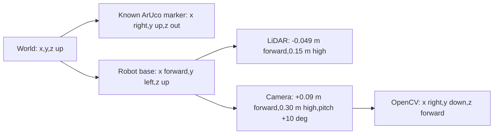

# Track A: visual waypoint navigation (development baseline)

This is a simulation baseline published for team review, not a complete assessment submission.
Group number, team names, human contribution statements and the final video
must be provided and verified by the team. No hardware result is claimed.

## Run from a fresh environment

```sh
python3 -m venv .venv
.venv/bin/python -m pip install -r requirements-camera.txt
.venv/bin/mjpython robotis_tb3/track_a_project.py --output track-a-output
```

Use `mjpython` on macOS for the passive viewer. Press Q to stop and close.
Other platforms can use `.venv/bin/python` for the viewer. All runs require
MuJoCo-compatible graphics, including headless camera rendering.

```sh
.venv/bin/python -m unittest discover -s robotis_tb3 -p test_track_a.py -v
.venv/bin/python robotis_tb3/track_a_project.py --headless --output trial
.venv/bin/python robotis_tb3/evaluate_track_a.py --trials 3 --seconds 75 --output evaluation
```

The previously added `camera_navigation.py` is a simpler visual-servo exercise;
it is not the assessed integrated pipeline. Use `track_a_project.py` here.

## Model and frames (Part A)

State s=[x,y,theta], in metres and radians. World z is up. Base x is forward,
base y is left, theta is anticlockwise from world x. Wheel inputs are measured
wheel-angle increments, not actuator command values. Wheel radius 0.0330085 m,
track 0.288 m, physics step 0.002 s and command limit +/-7.88 rad/s are read from
the actual ROBOTIS scene. EKF, camera, LiDAR and feedback updates are 10 Hz;
there are 50 physics steps per update.

With wheel rates wl,wr:

v=r(wl+wr)/2, omega=r(wr-wl)/b;
s_dot=[v cos(theta), v sin(theta), omega].

Encoder increments use the exact circular-arc integrator in `turtlebot_model.py`.
Assumptions: planar motion, equal wheel radii, rigid camera mounting, known
marker pose, and bounded unmodelled slip. The actual model has wheel friction
and motor lag, so commanded rates are not assumed to equal measured rates.

The continuous linearisation has A[0,2]=-v sin(theta), A[1,2]=v cos(theta).
B has rows [r cos(theta)/2,r cos(theta)/2],
[r sin(theta)/2,r sin(theta)/2],[-r/b,r/b]. The controllability rank is 3 while
moving and 2 at zero speed. This local rank drop does not make the nonlinear
robot unable to reposition by turning and driving.

The integrated camera supplies marker range, bearing, and heading inferred
from the known marker orientation. Its measurement Jacobian includes the
camera's 0.09 m forward offset and a heading row [0,0,1]. It has rank 3 away
from the marker. Range and bearing from a *single* landmark alone do not fix
all three absolute pose degrees of freedom: rotating the entire pose around
that landmark preserves these measurements. Do not reuse the old C=I claim
unless an actual full-pose or heading-bearing camera measurement is present.
Out of view there is no absolute correction; encoders alone accumulate drift.



## Sensing and calibration (Part B)

The scene has a simulated camera on a mast, not a claim about the stock
physical Waffle Pi camera. It is 960x720 with vertical FOV 90 degrees, square
pixels, focal length 360 pixels and principal point (479.5,359.5). Lens
distortion is zero by construction. The black marker square is 0.22 m;
its 0.30 m board includes a quiet zone. The known station is at (3,0,0.55) m.

OpenCV detects DICT_4X4_50 ID 0, refines corners, and solves square PnP.
Positive depth, finite values and reprojection error <=3 pixels are checked.
Marker orientation and fixed camera extrinsics convert PnP into horizontal
range, left-positive bearing, and base heading. This uses rendered RGB, never
the simulator's robot pose. LiDAR casts 181 rays over 360 degrees, adds 6 mm
Gaussian range noise by default, and has a 4 m maximum range. Encoder angles
are quantised to 1024 counts/revolution and a configurable wheel scale bias.

These intrinsics/extrinsics are specified by the simulated sensor. This is
not evidence of an independently estimated checkerboard calibration or a real
camera calibration. Quantitative image-derived measurement residuals should
be reported against independent simulator truth; real hardware needs separate
intrinsic/extrinsic calibration and noise measurement.

## EKF and tuning (Part C)

Prediction propagates encoder increments with F=df/ds and G=df/dwheel_delta.
Wheel increment standard deviations are 0.002+0.04*abs(delta) rad. Additional
process standard deviations per 0.1 s are 3 mm,3 mm,0.02 rad. The larger yaw
allowance was motivated by observed turning slip; a smaller setting rejected
valid camera updates after encoder heading drift.

R=diag(0.03^2,rad(1.5)^2,rad(8)^2), for range,bearing,heading. These are
initial engineering/tuning values, not measured manufacturer specifications.
`--r-scale` permits sensitivity experiments. Innovation angles are wrapped.
The 99% 3-DOF chi-square NIS gate is 11.345. Covariance uses the Joseph form
and is symmetrised. Missing frames skip correction. Initial pose prior is
[0.025,-0.02,0.025] with std [0.06,0.06,5 deg], referenced to a known nominal
start, not copied from ground truth.

## State feedback, planning and docking (Part D)

LiDAR endpoints are transformed using the EKF pose into a rolling 0.10 m
occupancy grid. Occupied cells are inflated by about 0.32 m for the robot
footprint and estimation margin. A* avoids diagonal corner cutting. A fixed
upper-side path-cost preference reduces switching between symmetric routes;
this favours continuity over the shortest path and is a documented trade-off.
The grid's room bounds are configured, but obstacle locations are not handed
to the planner. This rolling map is not SLAM and does not preserve unseen walls.

The nonlinear state-feedback path tracker uses the estimated pose, a 0.20 m
lookahead, speed 0.18*cos(heading_error) m/s, yaw gain 2.8/s, yaw saturation
0.8 rad/s, and rotates without advancing for heading errors over 0.4 rad.
The pre-dock waypoint is (1.95,0). The final estimated-pose target is
(2.36,0,0), about 0.55 m from camera to station. Docking translation uses gain 0.8/s and a minimum 0.10 m/s command to overcome
wheel friction. Dock heading uses a deadband relay at +/-0.8 rad/s because
smaller in-place commands stalled. Position capture latches before final yaw
alignment, preventing switching at the positional tolerance boundary.
Position capture enters below 3 cm and releases at 4 cm if an EKF correction
moves the estimate away. Arrival requires five accepted camera observations
within 4 cm and 0.08 rad. Gaps of at most two control frames (0.2 s) may preserve
confirmation evidence; longer gaps or an out-of-tolerance estimate clear it.
Missing images never advance or complete arrival. When the marker is lost during docking, only
rotation toward its EKF-predicted bearing is allowed; translation is disabled.
A forward LiDAR reading under 0.36 m suppresses translation. This is a
state-feedback waypoint/path tracker, not LQR or time-scheduled tracking.
Confirm that this trajectory interpretation matches the team's agreed scope.

## Integration and evaluation (Part E)

`track_a_sensors.py` confines simulator pose access to sensor generation and
named evaluation functions. `track_a_estimation.py` and `track_a_navigation.py`
accept no MuJoCo model/data. Ground truth is logged *after* computing commands
and never passed to the EKF or tracker.

Each run saves parameters, seed, full trace, estimated/true/odometry poses,
EKF covariance, camera updates, wheel commands, paths, NEES/NIS, camera frames,
and a result summary. Success requires estimated arrival, no recorded obstacle
collision, true final range within 8 cm of 0.55 m, lateral error below 8 cm,
and heading error below 0.15 rad. Simulator truth is used for these scores only.
The collision evaluator samples contacts every 0.02 s.

Repeated scenarios include nominal conditions, image noise plus 30% camera
dropout, a shifted obstacle with additional encoder bias, and reduced floor
friction. Failures are retained. Small trial counts do not prove broad robustness.
Compare RMSE, covariance coverage/NEES, path error, success rate and control
effort. Report failed tuning attempts and parameters honestly.

Development failures to retain in the discussion: symmetric route flipping,
underestimated yaw-slip uncertainty, camera loss during turns, and inability
to reacquire while a docking safety rule disabled every motion command.

## Measured development results after docking fix (two seeds per condition)

| Condition | Success | Mean EKF position RMSE | Encoder-only RMSE |
|---|---:|---:|---:|
| nominal | 2/2 | 0.057 m | 0.463 m |
| camera_noise_dropout | 2/2 | 0.054 m | 0.464 m |
| shifted_obstacle | 2/2 | 0.076 m | 0.591 m |
| slippery_floor | 2/2 | 0.054 m | 0.447 m |

Overall success is 8/8, with no recorded obstacle collisions. All 15 camera and
navigation regression tests passed, including four new docking/dropout cases.
The originally failing seed-0 noisy-camera trial now completes in 51.8 s under
the same 65 s limit, seed, pixel noise and dropout. Its final true lateral error
is 2.27 cm and heading error is 3.74 deg. Physical success thresholds were not
changed. Per-run parameters, traces and source hashes accompany these results.

The previous implementation completed 7/8 trials. It latched position capture
even when subsequent EKF corrections moved the estimate outside the arrival
band, and reset confirmation on every dropped frame. The fix captures inside
3 cm, releases at 4 cm, and preserves real camera confirmations across gaps up
to 0.2 s. Arrival still requires five actual accepted camera observations, and
longer gaps or an out-of-tolerance estimate clear the confirmation count. Original
failed logs are retained separately; they are not overwritten by the reruns.

This is a small simulation sample, not proof of broad robustness or a claimed
grade. Mean NEES still indicates room to improve estimator consistency. Report
uncertainty coverage and additional calibration/tuning studies before submission.

## Part C tuning evidence

See [Part C: EKF state estimation and tuning](PART_C_ESTIMATION.md) for the full
model, Q/R study, uncertainty trade-off and reproduction commands. Nine
configurations were replayed on eight fixed trajectories; the conservative
Q x10,R x1 candidate reduced reserved-trace position RMSE from 6.18 to 5.04 cm
but had mean NEES 0.98. Two separate fresh seed-2 online checks completed.
After the batch Q/R propagation fix, the candidate completed 8/8 online trials
on 28 October 2026 (two seeds per condition), with no recorded collisions or
timeouts. Mean per-trial position RMSE was 4.90 cm versus the archived baseline's
6.04 cm. These are online trials with changing trajectories; the baseline was
not rerun. [Report and plot](evidence/part-c/navigation-2026-10-28/Rerun-summary.txt).
Default Q/R scales remain 1/1. All 18 current regression tests passed. The
72 replay comparisons are not additional navigation-success trials.

## Submission items still requiring the team

- Group number, names, confirmed track/scope and human contribution statements.
- Review and understand every claimed component before the viva.
- Sensor calibration/validation evidence and defended Q/R/gain choices.
- Results and limitations from repeated trials, with uncertainty and truth plots.
- A five-minute video showing nominal completion and at least one varied trial,
  plus estimate uncertainty alongside truth. No video is claimed by this document.
- Publish the reviewed project page/code and provide actual Canvas links.

## Offline plots

Install `requirements-analysis.txt` and run:

```sh
.venv/bin/python robotis_tb3/analyse_track_a.py evaluation
```

This produces an error/uncertainty plot, sensor residual metrics, per-trial CSV,
and a summary. The plot uses simulator truth only for evaluation. Source files
are snapshotted and hashed at the start of each new integrated run.

## Sources and generative AI declaration

The repository inherits ROBOTIS MuJoCo robot assets and Billy's Part A model.
The original modelling notes identify the subject tutorial sources. Additional
baseline code was developed with OpenAI Codex assistance for sensor simulation,
OpenCV marker processing, EKF, planning/control, tests and documentation.
Codex also read the supplied marking guide and helped diagnose simulation
failures. The team must check, amend and include this AI-use declaration in its
submitted project page, and record human contributions accurately.

Technical references: OpenCV ArUco/PnP documentation and official MuJoCo Python,
XML camera, rendering and ray-casting documentation.

## Published evidence

See [evidence reproduction instructions](evidence/README.md), the [baseline results](evidence/baseline/Evaluation-summary.txt), and [Part C figures](evidence/part-c/tuning-comparison.png).
